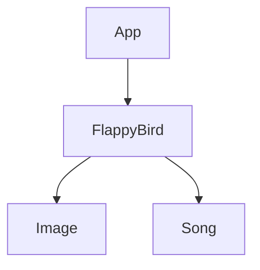

## 1. Stack
- Language: Java (JDK 8+, per REPO_ROOT/README.md)
- UI: `javax.swing` (JFrame, JPanel), `java.awt` (Graphics, rendering)
- Audio: `javax.sound.sampled` (AudioInputStream, Clip)
- No build tool / manifest found — compiled directly with `javac`

## 2. Directory map
| path | what lives there |
|---|---|
| `README.md` | Repo-level description of the game collection |
| `Project 1/` | Flappy Bird clone (only project present) |
| `Project 1/App.java` | Entry point — creates the JFrame window |
| `Project 1/FlappyBird.java` | Game panel — loop, physics, rendering, input, audio |
| `Project 1/Image/` | Sprite assets (bird, pipes, background) |
| `Project 1/Song/` | Audio assets (background music, game-over sound) |
| `Project 1/Photo/` | Development diagrams / screenshots (non-runtime) |
| `Project 1/Presentation/` | `Flappy Bird.pptx` project presentation (non-runtime) |
| `Project 1/README.md` | Placeholder title only ("# PublicProjectS") |

## 3. Diagram

## 4. Component index
- [[App]]
- [[FlappyBird]]
- [[Image]]
- [[Song]]

## 5. Entry points
- Dev/prod (no separate build observed): from `Project 1/`, run
  `javac App.java FlappyBird.java && java App` (per REPO_ROOT/README.md)
- Java entry method: `Project 1/App.java` → `public static void main(String[] args)`

## 6. Conventions (observed)
- No package declarations — both classes live in the default package (`Project 1/App.java`, `Project 1/FlappyBird.java`)
- Game entities modeled as inner classes of `FlappyBird` (`Bird`, `Pipe`) rather than top-level files
- Window/board size held as repeated constants `borderWidth = 360`, `borderHeight = 640` in both `App.java` and `FlappyBird.java` (not shared from one source)
- Assets loaded via relative paths from the class/working directory: `./Image/<file>` via `getClass().getResource(...)`, `./Song/<file>.wav` via `new File(...)`
- Exceptions from audio loading are caught and logged with `e.printStackTrace()` (`FlappyBird.java`), not propagated
- Inline comments mark OOP technique used at each site, e.g. `//abstraction`, `//polymorphism`, `//encapsulate` (`Project 1/FlappyBird.java`)

## 7. Where things go
- New sprite: add file to `Project 1/Image/`, load it in the `FlappyBird()` constructor via `new ImageIcon(getClass().getResource("./Image/<file>")).getImage()`
- New sound: add file to `Project 1/Song/`, load it in the `FlappyBird()` constructor via `AudioSystem.getAudioInputStream(new File("./Song/<file>"))`
- New obstacle/entity type: add an inner class to `Project 1/FlappyBird.java` following the `Pipe`/`Bird` pattern, then wire it into `move()` and `draw()`
- New game project: add a sibling `Project N/` folder at repo root with its own entry point, mirroring `Project 1`'s layout (per REPO_ROOT/README.md structure)
- Change window/board dimensions: update `borderWidth`/`borderHeight` in both `Project 1/App.java` and `Project 1/FlappyBird.java`
